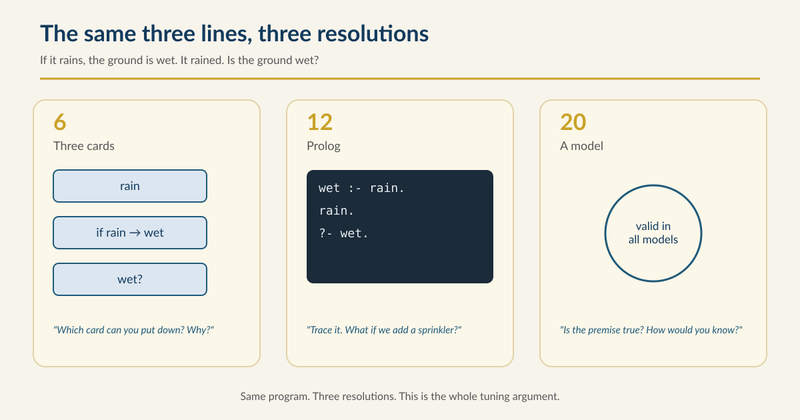
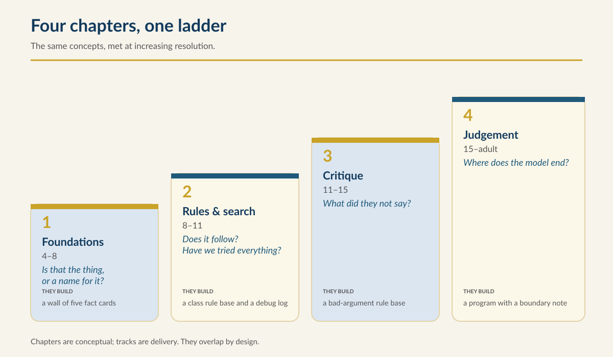
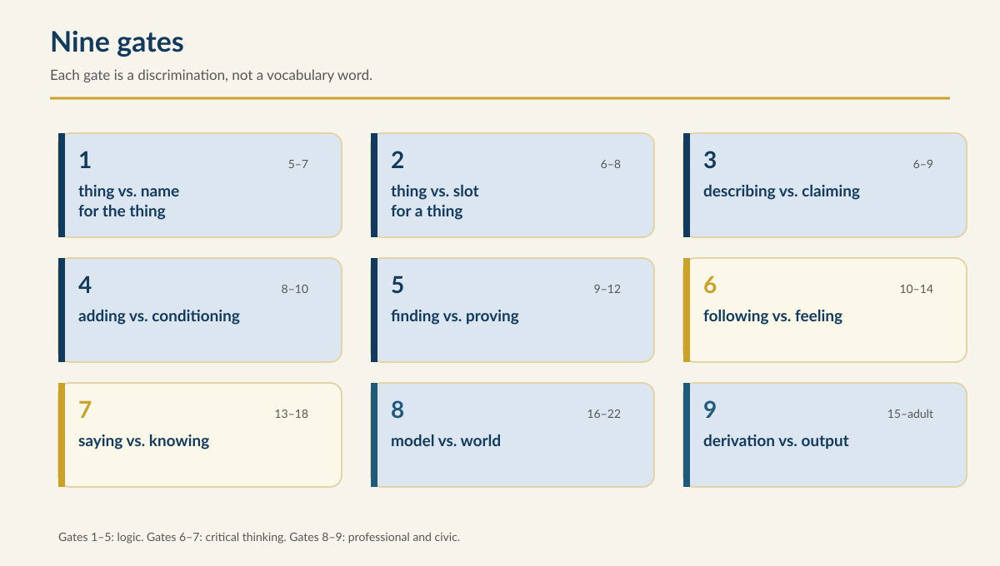
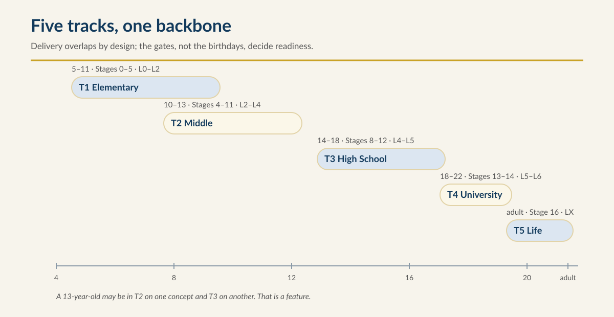
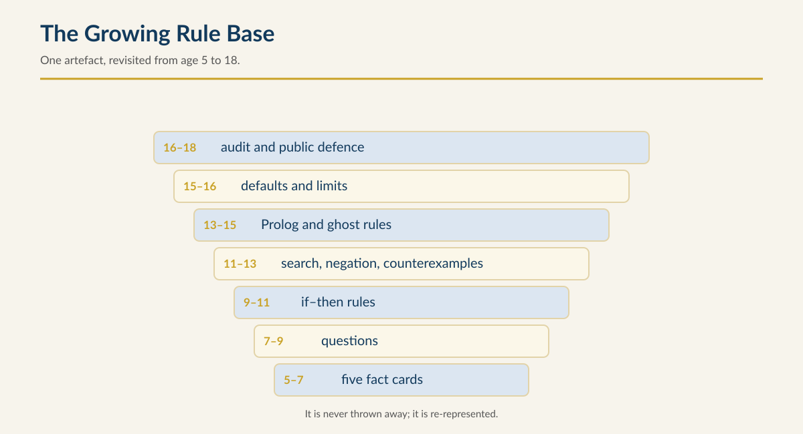
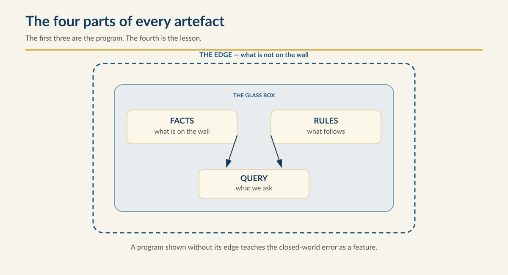
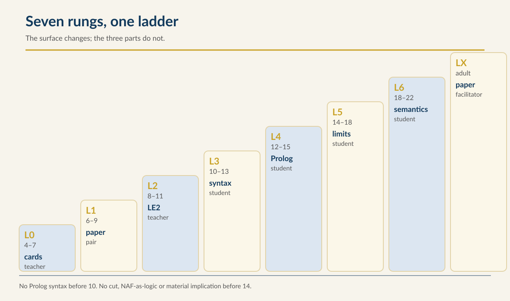
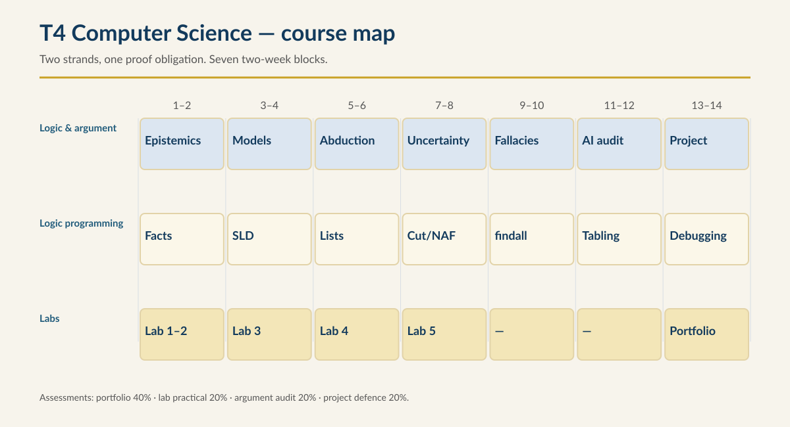
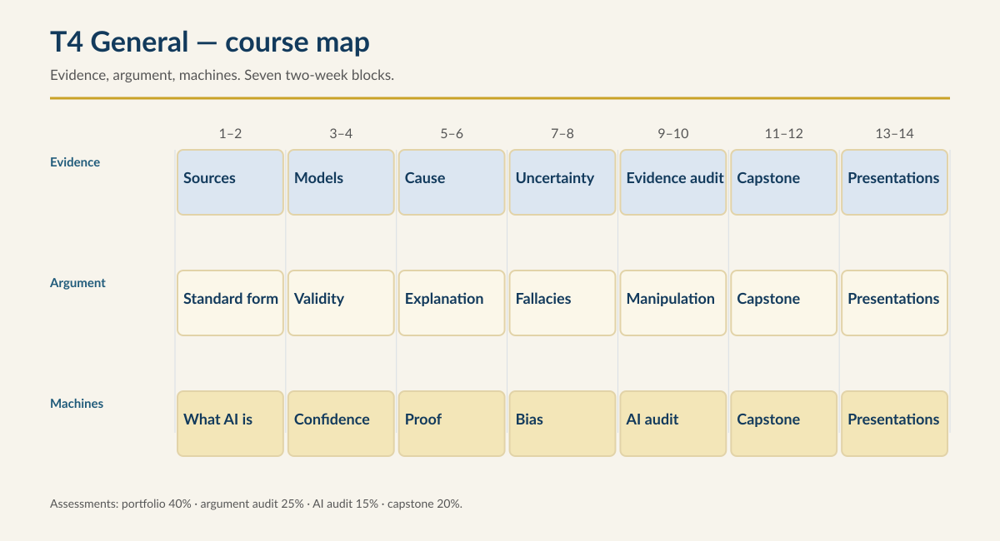
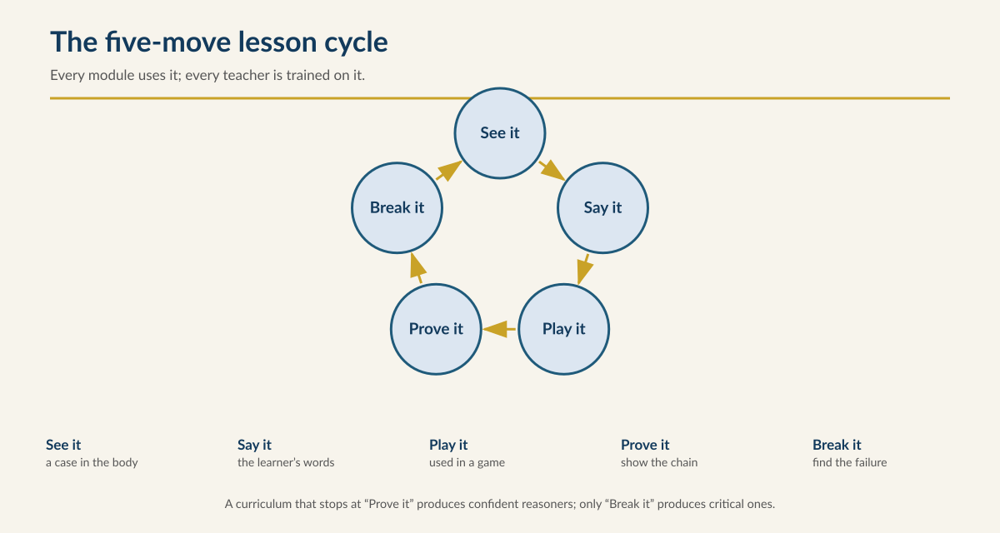

# ^ Preface

This is the central curriculum document. It stands on its own. A teacher, a school leader, a lecturer, a parent or a curriculum committee should be able to read it without opening another file, and should be able to teach from it after one careful reading.

The document has one argument. **The concepts of logical thinking do not change as students get older. Their resolution changes.** A permission rule at eight, a resolution step at twenty and a clause in a contract at forty are the same logical object met at different resolutions. If that is true, a single curriculum can run from the early years to adult life without insulting the youngest or patronising the oldest.

The second argument is about the machine. Logic programming — the family of languages in which we write down facts and rules and ask questions — is the best mirror we have for making reasoning visible. It is not a syllabus. It is not a substitute for logic. It is a glass box: the learner can see what is inside, test it, and change it. That is exactly what a confident chatbot denies.

The document therefore does three things at once. It is a **concept sequence** (what is taught, in what order, and why). It is a **curriculum** (five tracks, modules, lesson counts, artefacts and assessment). And it is a **teacher's handbook** (the lesson cycle, the language to use, the misconceptions to pre-empt, the point at which the machine enters and the point at which it must stay out).

It is not a textbook for students, and it is not a collection of worksheets. It is the plan from which those things are made.

# ^ Note on this edition

This document is the **design archive**. It contains the full stage cards, the seventeen-stage ladder, the gate passport prototype, the pilot plan and the figures. It is the place to go when a committee asks why the sequence is ordered as it is.

It is no longer the entry point to the curriculum. The classroom set is four grade-band documents, two university volumes and an adult volume, mapped in `00_Overview_and_Map.pdf`. A teacher should open the band document for her grade, not this file. The stage cards here remain the detailed design record behind those documents.

The rest of this archive is unchanged, apart from the references and the document-set list. Where it refers to "this document" as the curriculum, read "this archive". The document-set section at the end lists the current teaching set.

# ^ How to use this document

The document is organised in six parts.

| If you are... | Read first | Then |
|---|---|---|
| A teacher in the early years | Chapters 3–5, 7 (Stages 0–5), 13, 20–22 | Chapter 9 for the tuning rules |
| A middle-school teacher | Chapters 3–5, 7 (Stages 4–8), 14, 20–22 | Chapter 9 |
| A high-school teacher | Chapters 3–5, 7 (Stages 8–12), 15, 20–22 | Chapters 9–12 |
| A university lecturer | Chapters 3–5, 7 (Stages 13–14), 16, 19–20 | The T4 companion volumes |
| A parent or community facilitator | Chapters 3–4, 17, 21–22 | Chapter 9 |
| A principal or planner | Chapters 1–5, 19, 23–24 | Chapter 16 for the university bridge |

Three conventions run through the document.

**The stage card.** Every stage in Part II has the same shape: age, gate, chapter, discrimination, learning outcomes, core concepts, what learners do, the logic-programming bridge, assessment evidence and what is out of bounds. The shape is deliberate: a teacher can compare stages, and a curriculum committee can see exactly where a concept enters and where it is secured.

**The module.** A module is a teachable unit of four to nine lessons. Each module has a production task — something the learner makes, not something they recognise. The module tables in Part IV give the sequence; the stage cards give the substance.

**The figure.** Figures are not decoration. Each one carries an argument that is harder to see in prose: the ladder, the gates, the five tracks, the four parts of an artefact, the rungs, the same program at three ages, the growing rule base and the lesson cycle. A reader who only looks at the figures should still be able to explain the curriculum.

The document uses British spelling and international punctuation. Prolog code is set in a monospace face and is deliberately small; it is there to be read, not typed from the page.

# ^ Executive summary

## ^ The problem

Three failure modes are common.

First, **logic is taught as formulas**. Students learn a notation, pass an examination and drop the notation at the next examination. The formalism was never connected to a question they actually ask.

Second, **critical thinking is taught as scepticism**. Students learn to doubt everything, and therefore decide nothing. They acquire the vocabulary of critique without the apparatus of judgement.

Third, **AI gives confident answers with no chain**. A fluent answer is now cheap. The scarce skill is checking: reconstructing the chain, finding the missing premise, noticing what the model does not know.

The curriculum addresses all three with one move: it teaches the same concepts at the resolution the learner can handle, and it makes the reasoning visible at every step.

## ^ The claim

> **The concepts do not change as students get older. Their resolution changes.**

Implication at eight is a permission rule: *if you ride the bike, you must wear a helmet.* At fifteen it is a chain with a necessary and a sufficient condition. At twenty it is a resolution step in a proof. At forty it is a clause in a contract you did not read. Same gate, four resolutions.

The second half of the claim is what makes five curricula possible:

> **The logic-programming representation does not change either — facts, rules, query and the edge. Only its surface changes.**

A six-year-old can meet the representation as three cards. A twelve-year-old can meet it as three lines of Prolog. A twenty-year-old can meet it as a model. The concepts are constant; the surface is tuned.

## ^ The four chapters

The ladder is easier to hold as four chapters than as seventeen stages.

| Chapter | Ages | Question | What the learner builds |
|---|---|---|---|
| **Foundations** | 4–8 | Is that the thing, or a name for it? | A wall of five fact cards |
| **Rules and search** | 8–11 | Does it follow? Have we tried everything? | A class rule base and a debug log |
| **Critique** | 11–15 | What did they not say? | A bad-argument rule base |
| **Judgement** | 15–adult | Where does the model end? | A program or policy with a boundary note |

The seventeen stages still exist. The four chapters are how a teacher, a parent or a committee holds them in mind.

## ^ The five tracks

| Track | Ages | Stages | Rungs | Time | Exit evidence |
|---|---|---|---|---|---|
| **T1 Elementary** | 5–11 | 0–5, seeding 6–8 | L0–L2 | 60 lessons, ages 6–11 | *My Question Book* and one rule base explained aloud |
| **T2 Middle** | 10–13 | 4–11 | L2–L4 | 90 lessons | *Audit a Claim* portfolio and an interactive-fiction world |
| **T3 High School** | 14–18 | 8–12, plus 15 | L4–L5 | 120 lessons | *Limit of the Model* defence and a machine-answer audit |
| **T4 University** | 18–22 | 13–14, plus 15 | L5–L6 | 42 h core, 42 h LP | Argument audit and program defence |
| **T5 Life** | adult | 16, plus 15 | LX | 10 × 30 min | One decision changed and one question installed |

The tracks overlap by design. A thirteen-year-old may be in the middle track on one concept and the high-school track on another. The gates, not the birthdays, decide readiness.

## ^ The logic-programming ladder

Every artefact has four visible parts: **facts** (what is on the wall), **rules** (what follows), **query** (what we ask) and **edge** (what is not on the wall). The first three are the program. The fourth is the lesson.

The surface moves through seven rungs plus a life rung: body and cards (L0), paper rule cards (L1), natural-language executable rules in LE2 (L2), first syntax (L3), Prolog and constraints (L4), tabling and non-monotonic reasoning (L5), and full semantics (L6). The life track uses a one-page paper rule base (LX).

No Prolog syntax before ten. No cut, no negation-as-failure-as-logic and no material implication before fourteen. No executable artefact enters a module until the hand version exists, the learner can debug the rule base, and the learner can name one thing the program does not know.

## ^ What is new

1. **Order by discrimination, not vocabulary.** The sequence runs from symbol to model, not from formula to exercise.
2. **Variable and question are taught together.** A variable is a hole; a question is a hole.
3. **Recursion moves earlier, fallacies later.** Recursion is construction; fallacies are critique, and critique needs the counterexample apparatus first.
4. **Two concepts carry the critical-thinking load:** the closed-world assumption (*not in my list is not false*) and necessary versus sufficient (*a key is needed, but it is not enough*).
5. **P6 is explicit:** deduction preserves truth; it does not acquire it. Validity is the standard for the form of an argument; truth is the standard for its premises.
6. **Five tracks, one backbone, one mirror.** The same concepts are delivered at five resolutions, with logic programming as the mirror rather than the subject.

## ^ What the plenary is asked to decide

1. Keep the university core as one course, with the capstones as an optional second semester.
2. Appoint one owner for AI literacy, with three delivery variants: understanding at 10–13, supervised use at 14–18, professional use for adults.
3. Appoint one catalogue curator, with one schema and one submission format.
4. Approve Pilot A: two no-technology lessons at ages 9–10 — necessary versus sufficient and the ghost rule — measured by a three-week delayed post-test.

<!-- part: Part I — The case -->

# 1. The problem and the claim

## Three failures

The first failure is **formalism without a question**. A student can recite the definition of validity and cannot find a counterexample. The definition was taught before the experience it compresses. The curriculum reverses that order: the learner meets a counterexample first, and the definition arrives as a name for something they can already do.

The second failure is **critique without construction**. A student can name a dozen fallacies and cannot build a valid argument. Fallacy names become a debate tactic, a way of ending a conversation rather than inspecting it. The curriculum delays the names until the learner has built working rules, found a counterexample and debugged a rule base.

The third failure is **confidence without a chain**. A fluent answer is treated as evidence. This is the oldest error in the book, but it has a new scale. A machine can produce a paragraph in seconds; it cannot show you the derivation unless it is designed to, and most systems are not. The curriculum makes "show me the chain" a standing request from the first years to adult life.

## The wager

The wager is that these three failures have one root: **the learner has never seen reasoning as an object.** They have seen conclusions, and they have been asked to believe or reject them. They have not seen the machinery that connects a premise to a conclusion, or the point at which the machinery breaks.

Logic programming makes the machinery visible. A fact base is a list you can point at. A rule is a sentence you can read. A query is a question you can ask. A trace is a chain you can follow. A failure is a place where the chain stops. That is why the curriculum uses it, and why it refuses to start with its syntax.

## The claim

> **The concepts do not change as students get older. Their resolution changes.**

Consider one sentence: *if it rains, the ground is wet.*

| Age | What the learner sees | What the learner is asked |
|---|---|---|
| 6 | Three cards: rain, if rain then wet, wet? | Which card can you put down? Why? |
| 12 | `wet :- rain.` `rain.` `?- wet.` | Trace it. What if we add a sprinkler? |
| 20 | An interpretation in which rain is true; validity in all models | Is the premise true? How would you know? |
| 40 | A clause in a contract: if the event is a flood, the policy pays | What counts as a flood? Who wrote that definition? |

The logical object is the same. The resolution is different. A curriculum that respects this can hand a five-year-old, a nineteen-year-old and a parent the same idea without insulting any of them.

The second half of the claim is the design principle for the machine:

> **The logic-programming representation does not change either — facts, rules, query and the edge. Only its surface changes.**

{width=0.95}

## What this is not

It is not a claim that every child should become a programmer. Most will not. It is a claim that every learner should meet the shape of reasoning, and that the shape is easier to see when it is written down in a form that can be run.

It is not a claim that logic programming is logic. Prolog has depth-first search, negation as failure, the closed-world assumption and the cut. Those are design decisions, not laws of thought. The curriculum teaches them twice: once as a convenience, once as a distortion.

It is not a claim that critical thinking can be reduced to logic. Logic gives the questions; critical thinking is the habit of asking them when it costs something. The curriculum builds the habit through situations, not through slogans.

# 2. Design principles

Seven principles generate the sequence. They are not decoration; each one forbids a common curriculum mistake.

## P1. Order by discrimination, not by vocabulary

The teachable moment is not when a learner can *say* "variable". It is when they can tell a variable from a name — when they can see that "Ana" picks out one girl and "someone" could pick out any. Every stage is defined by one discrimination, and every stage has a failure symptom that tells you the learner is not there yet.

**What it forbids:** a syllabus organised by glossary order, in which the word arrives years before the experience.

## P2. Three passes per concept, never formal first

Each concept is met first in the body (enactive), then in a picture or diagram (iconic), then in words (verbal), and only then, if at all, in a formalism (symbolic). This is Bruner's triad, and it is also good sense: a learner who has physically walked a maze backwards knows something about backtracking that no amount of syntax will give them.

**What it forbids:** the worksheet before the game, the truth table before the counterexample, the Prolog clause before the paper rule.

## P3. Construct before critique

You cannot reliably spot a broken rule until you can build a working one and watch it work. Recursion therefore moves earlier, and fallacies move later. Fallacies are a critique skill; they need the full apparatus — counterexample, implicit premise, consistency check — which arrives at Stage 8. Taught before that apparatus exists, fallacies degenerate into a vocabulary quiz.

**What it forbids:** the fallacy-of-the-week syllabus, in which naming replaces thinking.

## P4. Every concept must become a question the learner asks themselves

The test of a concept is not that the learner can define it. It is that the learner spontaneously asks: *Does it follow? How do you know? What's missing? What would change my mind? Who benefits if I believe this?* Each stage names the question it installs.

**What it forbids:** assessment by recall of names.

## P5. Logic programming is a mirror, not a syllabus

The value of logic programming is that it makes a learner's own reasoning visible, testable and revisable. You write down what you know, ask a question, and the machine shows the chain. That is exactly the transparency a chatbot denies. But the machine also has quirks that are not logic and must not be mistaken for logic.

**What it forbids:** teaching the tool before the concept, and teaching the tool as if it were the concept.

## P6. Deduction preserves truth; it does not acquire it

Validity guarantees that *if* the premises are true, the conclusion is. It says nothing about whether they are. The premises of every deduction are themselves obtained non-deductively — by observation, measurement, testimony, induction or stipulation. The regress is unavoidable: to establish a set of premises deductively you need a further set, and the chain ends either in axioms or in non-deductive warrant. The last step of every establishment is non-deductive.

**What it forbids:** teaching validity without teaching the inputs, and teaching critique without teaching where premises come from.

## P7. The program is a mirror of the learner's reasoning, not a second subject

Three corollaries, all enforceable:

- **Time.** Logic-programming contact time never exceeds the concept time it serves. In the early years, the machine is on screen for no more than ten minutes of a forty-five-minute lesson.
- **Twin.** Every executable artefact has a paper twin. If the paper version does not exist, the executable version is not ready.
- **Assessment order.** A program is assessed first as a rule base ("is this true of the world?") and only then as a program ("does it run?"). The reverse order produces competent programmers who cannot tell when a machine is wrong about the world.

**What it forbids:** the coding club disguised as a logic curriculum.

# 3. The four chapters

The seventeen stages can be compressed into four chapters. Each chapter has one question, a small set of concepts and one visible artefact. The chapters are conceptual; the five tracks are delivery. They overlap by design.

{width=0.95}

## Foundations (4–8): *name it*

**Question:** Is that the thing, or a name for it?

The child meets sorting, same and different, the sign and the thing it stands for, and the difference between an object, its properties and its relations to other objects. The chapter is about representation: a map is not the territory, a word is not the thing, and a classification is a choice we make for a reason.

The visible artefact is a **wall of five fact cards**: five things the class knows, written down and displayed. The wall is the first fact base, although nobody calls it that.

## Rules and search (8–11): *use it*

**Question:** Does it follow? Have we tried everything?

The learner meets the hole (a variable and a question taught together), facts and sources, if–then rules, necessary versus sufficient conditions, backtracking and recursion. The chapter is about generation: a rule is a machine for producing new facts from old ones, and search is what you do when more than one rule could fire.

The visible artefact is a **class rule base and a debug log**: a small set of facts and rules the class owns, plus a record of the beliefs they changed when the rule base produced a wrong answer.

## Critique (11–15): *doubt it*

**Question:** What did they not say?

The learner meets consistency, counterexample and the ghost rule — the premise an argument needs but does not state. Fallacies arrive as questions, not names. Argument is distinguished from explanation, correlation from cause, and confidence from evidence. The chapter is about inspection: the learner turns their own reasoning, and someone else's, into an object they can test.

The visible artefact is a **bad-argument rule base**: a real argument reconstructed as facts and rules, with the missing warrant made explicit and the counterexample that breaks it.

## Judgement (15–adult): *judge it*

**Question:** Where does the model end?

The learner meets formal consolidation, models, logic programming as an object of study, the AI proof obligation and real decisions under uncertainty. The chapter is about limits: a derivation can be valid and its premise false; a program can return the right answer for the wrong reason; a model can be adequate for one purpose and misleading for another.

The visible artefact is a **program or policy with a boundary note**: a working artefact, plus a written account of what it does not know and where it would fail.

# 4. The nine gates

The four chapters are the story. The nine gates are the diagnostic. A gate is a discrimination that must be secure before the next one can land. A learner missing a gate will memorise the formalism and drop it at the first examination.

{width=0.95}

| Gate | The discrimination | Age | Failure symptom if skipped |
|---|---|---|---|
| 1 | Thing vs. **name** for the thing | 5–7 | Confuses the map with the territory; thinks defining a word settles a fact |
| 2 | Thing vs. **slot** for a thing | 6–8 | Cannot ask a general question; treats "someone" as a particular person |
| 3 | **Describing** vs. **claiming** | 6–9 | Cannot separate "what it is like" from "whether it is so" |
| 4 | **Adding** ("and") vs. **conditioning** ("if") | 8–10 | Treats a rule as a list; cannot see that a rule generates new facts |
| 5 | **Finding** vs. **proving** | 9–12 | Thinks the first answer found is the answer; cannot see that "I found one" is not "that's all there are" |
| 6 | **Following** vs. **feeling** | 10–14 | Accepts an argument because it is fluent, confident or emotionally satisfying |
| 7 | **Saying** vs. **knowing** | 13–18 | Treats testimony, repetition and virality as evidence |
| 8 | **Model** vs. **world** | 16–22 | Confuses the formalism with reality; thinks a proof settles a fact |
| 9 | **Derivation** vs. **output** | 15–adult | Accepts a conclusion because it was produced fluently, not because it was earned |

Gates 1–5 are logic. Gates 6–7 are critical thinking. Gates 8–9 are the professional and civic gates. Gate 9 is the one that decides whether a person can check a machine.

Gate 8 deserves a note. It is the gate most often missing in adults who have studied logic, and it is the reason a formally trained person can be worse to argue with than an untrained one. A model is a map. Soundness and completeness are properties of the map, not of the world. Someone who has Gate 8 can say "this derivation is valid and its premise is false" without discomfort. Someone who lacks it experiences every valid argument as a fact.

# 5. The five tracks

The five tracks are delivery containers, not five different subjects. They overlap because development is uneven: a learner can be at Stage 3 on one concept and Stage 5 on another. The gate passport in Chapter 20 records the gates, not the birthdays.

{width=0.95}

| Track | Ages | Stages | Rungs | Time | Exit evidence |
|---|---|---|---|---|---|
| **T1 Elementary** | 5–11 | 0–5, seeding 6–8 | L0–L2 | 60 lessons, ages 6–11 | *My Question Book* and one rule base explained aloud |
| **T2 Middle** | 10–13 | 4–11 | L2–L4 | 90 lessons | *Audit a Claim* portfolio and an interactive-fiction world |
| **T3 High School** | 14–18 | 8–12, plus 15 | L4–L5 | 120 lessons | *Limit of the Model* defence and a machine-answer audit |
| **T4 University** | 18–22 | 13–14, plus 15 | L5–L6 | 42 h core, 42 h LP | Argument audit and program defence |
| **T5 Life** | adult | 16, plus 15 | LX | 10 × 30 min | One decision changed and one question installed |

## Ownership

Group 1 owns Stages 0–5. Group 2 owns Stages 4–9 and shares 10–11 with Group 1. Group 3 owns Stages 8–12 and co-owns Stage 15 with Group 4. Group 4 owns Stages 13–14. Group 5 owns Stage 16 and, through parents, feeds Stages 0–2 back into Group 1.

The overlaps are intentional. A stage belongs to the group that can teach it best, not to the group that happens to have the age band. The handoff is at the gate, not at the birthday.

<!-- part: Part II — The body of knowledge -->

# 6. How to read a stage

Each stage card has the same nine fields.

**Age and gate.** The calibration and the discrimination. Age is a heuristic; the gate is the diagnostic.

**Chapter and rung.** Where the stage sits in the four chapters, and where the logic-programming artefact sits on the ladder.

**Discrimination.** The one thing the learner must be able to tell apart. If they cannot, the stage is not secure, regardless of age.

**Learning outcomes.** Three to five things the learner can do by the end, written as observable actions.

**Core concepts.** The vocabulary and the distinctions the stage introduces.

**What learners do.** The activities that make the concept land. These are examples, not a script.

**Logic-programming bridge.** The artefact, the surface and the question the machine is asked. If the stage has no machine, the card says so.

**Assessment evidence.** What goes into the gate passport: something the learner makes, explains or debugs.

**Out of bounds.** What not to do at this age, and why.

The stages are sequential in the order of discrimination, not in the order of vocabulary. A stage can be taught across several school years. A stage can be revisited at a higher resolution; the Growing Rule Base is designed for exactly that.

{width=0.95}

# 7. The stages

## Stage 0 — The ground floor (4–6)

**Gate:** 1 (seed) · **Chapter:** Foundations · **Rung:** L0

**Discrimination.** Same vs. different; mine vs. yours; now vs. before.

**Learning outcomes.** By the end, the learner can:
- sort a set by one attribute and say why they sorted it that way;
- sort the same set by a different attribute and defend the second sort;
- say "I don't know" and "how do you know?" without fear.

**Core concepts.** Attribute, group, same, different, before, now, mine, yours. The key idea is that a classification is a choice made for a reason, not a fact in the world.

**What learners do.** Sort a heap of mixed objects. Explain the sort. Sort the same heap another way. Introduce the two magic sentences: "I don't know" and "How do you know?" Both must be safe to say. Play "same and different" with sounds, shapes and people.

**Logic-programming bridge.** None. Not now, not soon. The bridge is conceptual: a fact base is a set of things we have chosen to put on the wall, and the choice could have been different.

**Assessment evidence.** The learner sorts a heap twice and explains both sorts; the teacher records the explanation, not the sort.

**Out of bounds.** Any notation; any activity labelled "logic"; alphabet drills.

## Stage 1 — Symbol (5–7)

**Gate:** 1 · **Chapter:** Foundations · **Rung:** L0

**Discrimination.** The sign is not the thing. "A" is not a sound; it stands for one.

**Learning outcomes.** By the end, the learner can:
- distinguish an icon, an index and a symbol;
- explain that a symbol is a convention, not a discovery;
- invent a symbol, teach it to another learner, and explain what it stands for.

**Core concepts.** Icon, index, symbol; map and territory; convention; homonym; context. The same letter sounds different in different words; the same word means different things in different sentences.

**What learners do.** Show a photo of a dog, a pawprint and the word "dog". Ask which looks like the thing, which points to it, and which is a convention. Draw a map of the classroom and hide a sweet; the map tells you where it is, but you cannot eat the map. Invent a symbol for something in the room and teach it to another child.

**Logic-programming bridge.** Atoms and quoted atoms; the difference between a name and what it names. No syntax. The conceptual point is that `mary` and `'Mary'` can be different objects, and that this is a design decision, not a law of nature.

**Assessment evidence.** The learner's invented symbol, and their explanation of what it does and does not represent.

**Out of bounds.** Syntax; notation drills; alphabet racing.

## Stage 2 — Objects, properties, relations (5–8)

**Gate:** 1–2 · **Chapter:** Foundations · **Rung:** L0–L1

**Discrimination.** A thing; a thing's attribute; a link between things.

**Learning outcomes.** By the end, the learner can:
- describe an object by its properties;
- describe it by its relations to other objects;
- explain why the order of a relation matters.

**Core concepts.** Object, property, relation, arity, argument order. Properties take one thing; relations take two or more. "Bigger than" and "smaller than" are the same link read in two directions.

**What learners do.** Describe-and-guess: one child describes an animal by properties only; the others guess. Then forbid properties and allow only relations ("it is next to the elephant", "it is bigger than the cat"). The game gets harder; that difficulty is the lesson. Build a family tree and a seating plan: two pictures of the same relations.

**Logic-programming bridge.** `has_feathers(tweety)`, `next_to(a, b)`. Arity as "how many holes". Argument order as a real decision with real consequences. The swapped-arguments bug starts here, not at fifteen.

**Assessment evidence.** A small world with three objects, three properties and three relations, drawn and explained.

**Out of bounds.** Variables. A relation with a hole in it is Stage 3.

## Stage 3 — The hole: variable and question (6–9)

**Gate:** 2 · **Chapter:** Foundations · **Rung:** L1

**Discrimination.** A name picks out one thing; a hole can be filled by many things, but if the same hole appears twice in one sentence, both occurrences must take the same filler.

**Learning outcomes.** By the end, the learner can:
- turn a statement with a gap into a question;
- explain why "someone" does not mean a particular someone;
- match a piece to a gap and say whether it fits.

**Core concepts.** Variable, question, substitution, anonymous variable, unification as "does this piece fit". The hole is not a thing; it is a place where a thing can go.

**What learners do.** Boxes and contents: a box, a label, contents, then a box with a question mark. Fill the blank: "___ is taller than ___" — can the same child fill both? The two-someones game: "A child gave a present to a child." One giver, one receiver, or the same child twice? Draw it. Then: "Every child gave a present to a child." How many drawings are possible?

**Logic-programming bridge.** `likes(X, ice_cream)`, `X = Y`, `_`. The anonymous variable as "a hole I don't care about". Unification as "does this piece fit", and the crucial asymmetry: a variable can be filled, an atom cannot.

**Assessment evidence.** A question card the learner wrote, with the hole marked, and two different fillers that both make sense.

**Out of bounds.** Scope and quantifier nesting as a formal topic. Keep it at the drawing level until ten.

## Stage 4 — Facts, sources and the third answer (7–9)

**Gate:** 3 · **Chapter:** Foundations · **Rung:** L1–L2

**Discrimination.** A claim that can be checked vs. a claim that cannot (yet); and "no" vs. "not in my list".

**Learning outcomes.** By the end, the learner can:
- give three answers: yes, no, not yet;
- rank three sources and give a reason;
- explain what breaks when a fact is removed from the class board.

**Core concepts.** Fact, source, testimony, evidence, belief revision, the third answer, the closed-world assumption. Knowledge is a list you can add to, remove from and revise — and the list is never the world.

**What learners do.** Yes / no / not yet: three cards; every question gets one of three answers, and "not yet" is a good answer. Who told you? The same fact from a friend, a teacher, a stranger, a book, a website. Rank the sources, then find a case where the ranking flips. The changing list: a "what we know about the class" board; add a fact, remove a fact, see what conclusions break.

**Logic-programming bridge.** Facts as ground atoms; a query returning true, false or looping — three answers, not two. Then the honest statement: Prolog says false when it means "not in the program". That is not the same as "not true". Say this out loud, early and repeatedly.

**Assessment evidence.** A source-ranking with a flip case, and a sentence about what the class board does not know.

**Out of bounds.** Formal source-evaluation rubrics and acronyms before eleven.

## Stage 5 — Rules and implication (8–10)

**Gate:** 4–5 · **Chapter:** Rules and search · **Rung:** L2

**Discrimination.** Adding facts (and) vs. generating facts (if).

**Learning outcomes.** By the end, the learner can:
- use and, or and not correctly in a rule;
- derive a new fact from a rule and a fact;
- distinguish "you need it" from "it is enough";
- reconstruct a chain from a conclusion.

**Core concepts.** Conjunction, inclusive disjunction, negation, implication, permission and obligation, necessary and sufficient conditions, chaining. The arrow does not run backwards.

**What learners do.** Six micro-concepts, in this order: and; or; not; if; necessary vs. sufficient; chain. Introduce if through permissions, not abstract conditionals: *if you ride the bike, you must wear a helmet.* The key/door rule base: a key is necessary to open the door; it is not sufficient, because the door may be bolted. Detective stories and rule-card games. The explanation game: one child states a conclusion; another reconstructs the chain.

**Logic-programming bridge.** `head :- body`, `,` for and, `;` for or, `\+` for not. The proof tree is "show me how you got there" made literal. This is where Prolog starts to earn its place.

**Assessment evidence.** A three-rule rule base and a chain the learner can explain aloud; a counterexample to "if A then B".

**Out of bounds.** Material implication; the cut; negation as failure as logic.

## Stage 6 — Search and backtracking (9–11)

**Gate:** 5 · **Chapter:** Rules and search · **Rung:** L2–L3

**Discrimination.** Trying vs. finding vs. having tried everything.

**Learning outcomes.** By the end, the learner can:
- walk a maze, hit a wall, and return to the most recent choice point;
- explain why the first answer found is not necessarily the only answer;
- prove that a small search space has been exhausted.

**Core concepts.** Choice point, branch, backtracking, undo, exhaustiveness, completeness. Order of trying affects speed, not correctness.

**What learners do.** Walk the maze physically. Hit a wall. Walk backwards to the last junction — not to the start. Guess Who / twenty questions: every question is a choice point; draw the tree. The undo rule: any game where a move must be completely undone. Have we tried everything? Give a small problem with a hidden second solution; the group that stops at one answer loses.

**Logic-programming bridge.** `;` in the shell; watch the engine go back and try again; `trace` as a slowed-down maze walk; `repeat`, `fail`. Show that the program undoes bindings on backtracking, and connect it to the counters going back.

**Assessment evidence.** A search log with a marked choice point, a failed branch and a proof of exhaustion.

**Out of bounds.** The cut before fourteen.

## Stage 7 — Recursion (9–12)

**Gate:** 5 · **Chapter:** Rules and search · **Rung:** L3

**Discrimination.** "The same shape again, but smaller" vs. "a different thing that happens to repeat".

**Learning outcomes.** By the end, the learner can:
- find the floor in a nested story or object;
- write a recursive rule with a base case and a step;
- explain why a rule with no floor never stops.

**Core concepts.** Recursion, base case, recursive step, termination. Every recursion needs a floor — a case that does not call itself.

**What learners do.** Russian dolls; the song that never ends; a story within a story; "the house that Jack built". The ancestor question: "My parent is my ancestor, and my parent's ancestor is my ancestor." How far back does the question go, and what stops it? No floor: tell a rule with no base case and watch it run forever, physically, with a chain of children each passing the question to the next.

**Logic-programming bridge.** `ancestor(X, Y) :- parent(X, Y).` and `ancestor(X, Y) :- parent(X, Z), ancestor(Z, Y).` The two-clause shape — floor, then step — is the thing to internalise. Then the deliberate infinite loop, and the question: what would you add?

**Assessment evidence.** A recursive rule with a marked floor and step; a demonstration of what happens when the floor is removed.

**Out of bounds.** Accumulator pairs, tail recursion and complexity. Never at this stage.

## Stage 8 — Consistency, counterexample and the ghost rule (10–13)

**Gate:** 6 · **Chapter:** Critique · **Rung:** L3–L4

**Discrimination.** "This conclusion is wrong" vs. "these beliefs cannot all be true at once".

**Learning outcomes.** By the end, the learner can:
- find the pair of statements that cannot both be true;
- produce a counterexample to a general claim;
- write down the premise an argument needs but does not state;
- debug a rule base and say which belief is wrong.

**Core concepts.** Consistency, contradiction, counterexample, implicit premise, warrant, belief revision. A set of beliefs is a system; you test the system, not the sentence.

**What learners do.** Can these all be true? Give four statements, three of which cannot coexist. Hunt the counterexample: "All birds fly" — penguin. The ghost rule: listen to an advert, a politician, a family saying; write down what they did not say. Debug the rule base, not the answer: give the group a rule set that produces a wrong answer; their task is to find the wrong belief. The two-column page: What we know / How we know it.

**Logic-programming bridge.** `\+` used honestly; a program that is internally consistent but externally wrong; adding a fact and watching a previously true conclusion die. This is non-monotonicity met as an experience, not a term.

**Assessment evidence.** A ghost-rule card; a debug log showing a belief the learner changed; a counterexample they found against their own first answer.

**Out of bounds.** Truth tables; validity and soundness as formal definitions. The ideas are in play; the terminology waits.

## Stage 9 — Fallacies (10–14)

**Gate:** 6 · **Chapter:** Critique · **Rung:** L4

**Discrimination.** "It follows" vs. "it feels like it follows".

**Learning outcomes.** By the end, the learner can:
- ask the generic detector: "does that actually get you there?";
- name a fallacy only after asking the question that kills it;
- construct a bad argument on purpose and explain its form.

**Core concepts.** Non sequitur as the genus; the tiered species: ad hominem, bandwagon, authority, emotion, tu quoque, consequences; false dilemma, hasty generalisation, circularity, straw man, slippery slope, composition and division; equivocation, ambiguity, loaded question, framing; post hoc, cum hoc, base rate, conjunction, survivorship, cherry-picking; manipulation techniques.

**What learners do.** Teach each fallacy as a question, not a name. Tier 0: "So what? How does that get you there?" Tier 1: "Is that about the claim, or about the person or feeling?" Tier 2: "Are there other options? How many cases? Is the premise just the conclusion again?" Transposition: replace the content-carrying terms, preserve the form, see what survives. Invent the fallacy: produce a bad argument on purpose.

**Logic-programming bridge.** A rule base of a bad argument: the stated premises, the missing warrant, the conclusion. Query it and see the gap. The transposition technique is the same move in prose.

**Assessment evidence.** A transposed argument and an honest report of whether it still persuades; one invented fallacy with its form labelled.

**Out of bounds.** Names before questions; fallacy-naming as a debate tactic.

## Stage 10 — Arguments in the wild (12–15)

**Gate:** 6–7 · **Chapter:** Critique · **Rung:** L4

**Discrimination.** An argument vs. an explanation; correlation vs. cause; "probably" vs. "certainly".

**Learning outcomes.** By the end, the learner can:
- reconstruct a real argument in standard form;
- distinguish an explanation from an argument;
- ask the three causal questions;
- sort claims by strength and say whether the evidence supports that strength;
- steelman a view before attacking it.

**Core concepts.** Claim, grounds, warrant, rebuttal, qualifier; explanation; correlation, cause, reverse causation, common cause, coincidence; uncertainty language; steelman; burden of proof.

**What learners do.** Take a paragraph from a newspaper, a policy document or a court judgment and put it in standard form. Attack it, then defend it against the attack. Ice cream and drowning: could it be reversed? Could a third thing cause both? Is it coincidence? Sort claims by strength: always, usually, often, sometimes, never, probably, possibly. Steelman: restate the other view so well that its holder says "yes, that's what I meant."

**Logic-programming bridge.** Encode two competing explanations as two rule bases and ask which one the facts support. Not a proof of causation — and saying so is part of the lesson.

**Assessment evidence.** A standard-form reconstruction, an attack and a defence; a steelman of a view the learner disagrees with.

**Out of bounds.** CRAAP-style rubrics; formal statistics.

## Stage 11 — Misinformation, trolling and manipulation (14–18)

**Gate:** 7 · **Chapter:** Critique · **Rung:** L4–L5

**Discrimination.** Mistake vs. disagreement vs. bullshit vs. trolling vs. manipulation.

**Learning outcomes.** By the end, the learner can:
- classify a piece of speech by its goal, not only its content;
- name the technique and refuse the frame;
- build a manipulation, then explain which one they would fall for.

**Core concepts.** The four-way distinction; the manipulator's toolbox (decontextualise, fabricate, impersonate, polarise, scapegoat, flood, emotion-first); prebunking; lateral reading; the portable counter-moves (stop, source, corroborate, trace, name, refuse the frame, ask for the mechanism, compared to what, steelman, exit).

**What learners do.** Walk a mile in the manipulator's shoes: take a real photo and change the caption; write a fake quote in the style of a real person; make a fake account for a real institution; write two posts designed to make each side furious; bury one true claim under twenty trivial ones. Then debrief: which was easiest? Which would you fall for? The confession is the learning.

**Logic-programming bridge.** A manipulator's rule base: `trusts(X, claim) :- wants(X, belong), repeats(in_group, claim).` Query it. Seeing your own susceptibility written as a rule is more persuasive than a lecture, and it teaches that the manipulation is in the structure, not the content.

**Assessment evidence.** A manipulation artefact with a debrief; a counter-move card the learner can use.

**Out of bounds.** "Media literacy" as a list of tips; naming techniques without practising the refusal.

## Stage 12 — Formal consolidation (15–18)

**Gate:** 8 · **Chapter:** Judgement · **Rung:** L5

**Discrimination.** Model vs. world.

**Learning outcomes.** By the end, the learner can:
- build a truth table and read it;
- distinguish validity from soundness;
- handle quantifiers without collapsing "everyone loves someone" into one reading;
- explain the limits of classical logic and of Prolog;
- find the boundary of a model.

**Core concepts.** Truth table, interpretation, model, validity, soundness, quantifier, scope, completeness, closed world, negation as failure, depth-first incompleteness, non-monotonicity, the cut.

**What learners do.** Truth tables for small propositions. Validity and invalidity for the same sentence, both ways. Quantifier drawings: "everyone loves someone" — one beloved for all, or a different beloved for each? Prolog limits lab: a program that returns the right answer for the wrong reason; a program that loops; a program whose silence is mistaken for falsehood. The mature move: the machine is a model of reasoning, and every model has a boundary. Ask them to find the boundary.

**Logic-programming bridge.** Prolog as a logic engine with named limitations. The declarative and procedural readings written side by side. The question: why is a right answer still a wrong program?

**Assessment evidence.** A truth table and a countermodel; a boundary note for a program; a written explanation of one limit.

**Out of bounds.** Logicism; Prolog as a synonym for logic; theorem-proving for its own sake.

## Stage 13 — University: logical thinking (18–22)

**Gate:** 8–9 · **Chapter:** Judgement · **Rung:** L5–L6

**Discrimination.** Validity vs. strength; model vs. world.

**Learning outcomes.** By the end, the student can:
- reconstruct and audit a real argument;
- prove validity and invalidity for the same sentence;
- rank explanations by explicit criteria;
- identify the hidden assumptions in a policy and re-derive after withdrawing one;
- state what would change their mind.

**Core concepts.** Epistemics and testimony; standard form; models; search; production systems; abduction; model theory; temporal and action theories; non-monotonicity; uncertainty; fallacies; AI and the proof obligation.

**What learners do.** The full university sequence in Chapter 16. The production tasks are mandatory: an argument audit, a countermodel, a plan derived backwards, a production system, a ranked set of explanations, a policy re-derivation, a machine-answer audit.

**Logic-programming bridge.** LE2, LPS2 and Prolog as mirrors for the formal units; the LP track is a separate companion volume for computer-science students.

**Assessment evidence.** Portfolio of production tasks; argument audit; written examination; oral explanation of one unit to a first-year student.

**Out of bounds.** Teaching validity without inputs; teaching models without countermodels.

## Stage 14 — University: logic programming (18–22)

**Gate:** 8–9 · **Chapter:** Judgement · **Rung:** L6

**Discrimination.** Convenience vs. distortion.

**Learning outcomes.** By the end, the student can:
- write, trace and debug a Prolog program;
- explain the declarative and procedural readings of the same program;
- identify where a feature changes the semantics, not just the speed;
- defend a program with a documented boundary.

**Core concepts.** Unification, SLD resolution, recursion, terms, arithmetic, cut, negation as failure, findall, CLP(FD), tabling, ASP and s(CASP), declarative debugging.

**What learners do.** The fourteen-week LP track in the T4 computer-science companion. Every feature is taught twice: once as a convenience, once as a distortion. The habit: write both readings. Where they diverge, the divergence is the lesson.

**Logic-programming bridge.** This is the stage where logic programming is the object of study, not the mirror.

**Assessment evidence.** A working program, a dual reading, a declarative debug, a public defence.

**Out of bounds.** Syntax-first teaching; a program that returns the right answer but cannot be explained.

## Stage 15 — AI literacy (10–adult)

**Gate:** 9 · **Chapter:** Judgement · **Rung:** L2–L6, LX

**Discrimination.** Derivation vs. output.

**Learning outcomes.** By the end, the learner can:
- ask for the chain and reconstruct it, or refuse the claim;
- distinguish confidence from calibration;
- test a system on something absent and notice the confabulation;
- explain who is responsible for a delegated decision.

**Core concepts.** Model vs. world; testimony vs. evidence; derivation vs. output; confidence vs. calibration; closed world and confabulation; rules and bias; agency and delegation; alignment as conflicting rule bases; optimisation and attention; verification and refusal.

**What learners do.** Three variants: understanding only at 10–13 (no accounts); supervised use at 14–18; professional use for adults. The standing rule: any machine answer must come with a chain the learner can reconstruct. The reframe test: ask the same question twice with opposite framings and watch the answer move.

**Logic-programming bridge.** The AI strand is the nine gates pointed at a machine. The manipulator's rule base and the closed-world test are the same artefacts at a new object.

**Assessment evidence.** A machine-answer audit; a chain reconstruction or a reasoned refusal; a responsibility statement.

**Out of bounds.** Accounts under thirteen; tool-first teaching; treating fluency as evidence.

## Stage 16 — Life: thinking skills (adult)

**Gate:** 6–9 (repair) · **Chapter:** Judgement · **Rung:** LX

**Discrimination.** Situation vs. concept.

**Learning outcomes.** By the end, the participant can:
- name the question that fits a real decision;
- write a one-page rule base of the situation;
- say what would change their mind;
- use one counter-move in a real conversation.

**Core concepts.** Authority, base rates, necessary vs. sufficient, risk, implicit premises, definitions, source, corroboration, emotion-first design, ghost rule, steelman, ad hominem, false dilemma, burden of proof, derivation vs. output.

**What learners do.** Ten sessions, one situation each: the doctor's waiting room; the contract you did not read; the thing you want to share; the family argument; the number in the meeting; the loan or purchase; the political claim; the AI answer at work; the "study says" headline; the neighbour or colleague. One question per session; one card; no homework.

**Logic-programming bridge.** A one-page paper rule base (LX), or one screen for the AI session. The machine is optional; the chain is not.

**Assessment evidence.** None in the school sense. Three questions at the end and one three weeks later: What did you do differently? Which question did you catch yourself asking? Where did it fail to work?

**Out of bounds.** Jargon without a situation; a course that starts with the syllabus; homework.

<!-- part: Part III — The logic-programming ladder -->

# 8. The mirror

Logic programming is the family of languages in which a program is a set of facts and rules, and a computation is a question asked of them. Prolog is the canonical member; Datalog, ASP and constraint languages are relatives. The family matters because it gives the learner three things that prose does not.

**A fact base you can point at.** What the program knows is a list. You can add a fact, remove a fact and watch a conclusion change. This is belief revision made concrete.

**A rule you can read.** A rule is a sentence with a head and a body: *the door can open if you have the key and the door is unbolted.* The logical form is visible, and so is the direction of support.

**A chain you can follow.** A query produces a trace. The trace shows which rule fired, which fact it used and where it went back to try another branch. That is "show me the chain" made literal.

The curriculum uses the mirror for three purposes: to make the learner's reasoning visible, to make it testable, and to make it revisable. It does not use it to teach syntax first, and it does not pretend that the machine's answer is the truth.

> **The machine is a model of reasoning. Every model has a boundary. The boundary is the lesson.**

# 9. Four parts and four dials

## The invariant

Every logic-programming artefact in this curriculum has four visible parts.

{width=0.95}

| Part | Child-facing name | What it is |
|---|---|---|
| **Facts** | What is on the wall | The ground atoms the program is given |
| **Rules** | What follows | The clauses that generate new facts |
| **Query** | What we ask | The question put to the engine |
| **Edge** | What is not on the wall | The boundary: what the program cannot know, and what its silence means |

The first three are the program. The fourth is the lesson. A program shown without its edge teaches the closed-world error as a feature. Every module that uses logic programming must make the edge visible, verbally and on the page.

## The four dials

When a module moves up or down a track, four dials change. The concept stays fixed.

| Dial | Younger or novice | Older or expert |
|---|---|---|
| **Surface** | none, cards, natural language | syntax, semantics |
| **Agency** | teacher runs, pair | learner runs, designs, specifies |
| **Granularity** | three facts, ten facts | thirty facts, modules, full programs |
| **Reflection** | the answer, the chain | the rule base, the design, the limits |

Age is a proxy; the dials are the mechanism. A bright nine-year-old can be at L3 on agency and L1 on surface. A nervous teacher can run L2 with L0 confidence. The gate passport records the dial positions, not the birthday.

# 10. The seven rungs

{width=0.95}

| Rung | Ages | Surface | Who runs the engine | Typical size | What is inspected |
|---|---|---|---|---|---|
| **L0** | 4–7 | body, objects, cards | teacher or a child | 3–5 facts | the answer: what follows? |
| **L1** | 6–9 | paper rule cards, wall board | pair, teacher as engine | 5–10 facts, 1–3 rules | the chain: how did we get there? |
| **L2** | 8–11 | LE2 on one screen, teacher-scribed | teacher scribes, class queries | 10 facts, 3–5 rules | the rule base: what does it know? |
| **L3** | 10–13 | LE2 to Prolog translation, first syntax | student types or dictates | 20 facts, 5–10 rules | the trace: what did it try, in what order? |
| **L4** | 12–15 | Prolog, Inform 7, CLP(FD) | student owns the program | 50+ facts, modules | the design: why these rules, this order? |
| **L5** | 14–18 | Prolog with tabling, ASP and s(CASP) | student designs and audits | multi-module, constraints | the limits: where is the model wrong about the world? |
| **L6** | 18–22 | full logic programming: semantics, SLD, soundness, completeness | student specifies | full programs | the semantics: what does this program mean? |
| **LX** | adult | paper, or one screen, facilitated | facilitator and group | one page | the hidden premise: what has to be true for this to be fair? |

The tuning rule, in one line per track:

- **T1:** the engine is a person; the program is a poster.
- **T2:** the engine is a browser; the program is a page the class owns.
- **T3:** the engine is Prolog; the program is an artefact with a boundary.
- **T4:** the engine is the object of study.
- **T5:** the engine is the conversation; the program is a card.

## The guardrails

No Prolog syntax before ten. No cut, no negation-as-failure-as-logic and no material implication before fourteen. No base rates, conjunction fallacy or regression before fifteen. No source-evaluation rubric before eleven. No truth table before twelve.

These are not claims about what children *can* do. They are claims about what a concept *needs* before it can land. A child can memorise a truth table at eight; that is not the same as having a proposition to tabulate.

# 11. The same program at six ages

| Age | What is on the page | What the learner is asked |
|---|---|---|
| 6 | Three cards: rain, if rain then wet, wet? | Which card can you put down? Why? |
| 9 | LE2: `if it rains then the ground is wet. it rains. ? the ground is wet.` | Say the chain out loud. What would make it false? |
| 12 | Prolog: `wet :- rain.` `rain.` `?- wet.` | Trace it. What if we delete `rain`? What if we add a sprinkler? |
| 16 | An interpretation in which rain is true; validity in all models | The derivation is valid. Is the premise true? How would you know? |
| 20 | SLD refutation; soundness; the premise as a measurement or testimony | What does the proof establish, and what does it not? |
| 40 | A clause in a contract: if the event is a flood, the policy pays | What counts as a flood? Who wrote that definition? What is not covered? |

Same three lines. Six resolutions. This is the backbone argument in one artefact.

# 12. Tools, guardrails and the admission rule

## The LP Admission Rule

A module may use an executable artefact only if all three tests pass:

1. **The hand version exists.** The learner has done the thing physically or on paper, and the paper twin is in the teacher pack.
2. **The learner can debug the rule base.** Given a wrong answer, they ask *which belief is wrong?* — not merely *which line do I change?*
3. **The learner can name one thing the program does not know.** They can point to the edge of the fact base and say what is absent.

If any test fails, the artefact stays out of that module. The concept is taught by hand. This single rule protects the curriculum from becoming a syntax course with logic painted on.

## The tool map

| Tool | What it gives | What it costs | First use | Guardrail |
|---|---|---|---|---|
| **Unplugged cards** | no dependency, full teacher control, works everywhere | slow; relies on teacher energy | L0 | the default; every executable artefact needs a card twin |
| **LE2** (Logical English) | natural-language syntax; resolution visible; closes the gap between English and logic | browser and connectivity; a teacher willing to scribe | L2 (8+) | teacher-scribed until 10; one screen per class, not one per child |
| **LPS2** | IDE, worked examples, trace | install or account; the interface can dominate the lesson | L3 (11+) | only after the paper trace |
| **Prolog** | full language; the canonical mirror; proof tree | syntax barrier; quirks mistaken for logic | L3 (10+ syntax; 12+ independent) | never before the hand version; cut and negation as failure only at 14+ |
| **CLP(FD)** | constraints; propagation visible | can look like magic; hides search | L4 (14+) | after search and recursion |
| **s(CASP) / ASP** | non-monotonic reasoning; stable models | conceptual load; installation | L5 (15+) | after defaults and belief revision |
| **Inform 7** | interactive fiction; natural-language rules; high engagement | a world-building tool, not a logic teacher | L4 (11+) | use for the project, not the concept lesson |
| **Paper and offline pack** | always available; printable; parent-friendly | production cost | all | required for every module |

## Convenience and distortion

Every feature is taught twice: once as a convenience, once as a distortion. This is the pedagogical core of the upper tracks.

| Feature | The logical concept it implements | The distortion it introduces | The question the learner must answer |
|---|---|---|---|
| Unification | identity and matching | bidirectional matching is not symmetric in time or cost | When is `X = Y` a test and when an assignment? |
| Closed world | "not in my list" | false means "not derivable", not "false" | Where does my program's silence become a lie? |
| SLD resolution | search over derivations | depth-first is incomplete on infinite branches | What would a fair search have found? |
| Negation as failure | negation | `\+` is not classical negation | Which of my "not"s are real negations? |
| The cut | commitment, a control decision | destroys the declarative reading; correctness becomes order-dependent | What did I lose the right to say? |
| Arithmetic | evaluation | `is` is not unification; arithmetic is not relational | Which of my relations are actually functions? |
| Recursion | self-similarity | termination is not guaranteed by the syntax | What is my base case, and is it reachable? |
| DCGs | grammar as recursion | parsing is not generation; left recursion loops | Does my grammar terminate in both directions? |
| findall and setof | quantifiers | collecting all solutions presupposes that all are found | Did the search actually exhaust? |
| CLP(FD) | constraint satisfaction | propagation is not search; a fixpoint is not an answer | Which part is reasoning and which is enumeration? |
| Tabling | termination for programs that should not terminate | tabling changes the semantics, not just the speed | What does my program mean now? |
| ASP and s(CASP) | non-monotonic and hypothetical reasoning | stable models are not "the truth"; they are one consistent reading | Which model did I choose, and why? |
| Declarative debugging | diagnosis | the bug is in a rule, not in an answer | Which belief is wrong? |

<!-- part: Part IV — The five curricula -->

# 13. T1 — Elementary (5–11)

**Entry:** no prerequisite. **Exit:** Gates 1–4 secure; Gates 5–6 seeded; the learner asks "how do you know?" and "what did they not say?" without prompting.

**Tuning rule:** the engine is a person; the program is a poster. No individual screens. One class screen from nine, teacher-scribed; independent typing begins in T2.

**Time:** 60 dedicated lessons (12 per year, ages 6–11), plus a daily five-minute question routine. The 5–6 year uses the first three modules embedded in play.

| # | Band | Module | Lessons | Stage and gate | LP artefact | Production task |
|---|---|---|---|---|---|---|
| 1 | 5–7 | Same and different | 5 | 0, Gate 1 seed | wall of five object cards (L0) | sort the same heap twice; defend both |
| 2 | 5–7 | The sign is not the thing | 5 | 1, Gate 1 | label cards and an invented symbol (L0) | invent a symbol; teach it to another child |
| 3 | 5–7 | Things, properties, links | 5 | 2, Gates 1–2 | property cards and a relation chain (L0) | invent a world: three objects, three properties, three relations |
| 4 | 7–8 | The hole | 5 | 3, Gate 2 | question cards, matching pieces, two-someones (L1) | fill the blank; draw the two readings of "a child gave a present to a child" |
| 5 | 7–8 | What is on the wall | 5 | 4, Gate 3 | class fact board; yes, no, not yet (L1) | rank three sources; remove a fact and report what broke |
| 6 | 7–8 | And, or, not | 5 | 5a–c, Gate 4 | rule cards (L1) | build a rule-card set; find the case where "not" means "no evidence" |
| 7 | 9–10 | If | 5 | 5d, Gate 4 | house rules in LE2, one screen (L2) | derive three new facts from the class rules |
| 8 | 9–10 | Need vs. enough | 5 | 5e, Gate 4 | key and door rule base with a missing condition (L2) | say "you need it, but it's not enough" in three situations |
| 9 | 9–10 | Show me the chain | 5 | 5f, Gates 4–5 | chain board; first trace (L2) | reconstruct the chain from a conclusion |
| 10 | 10–11 | Try, undo, try again | 5 | 6, Gate 5 | maze log; Guess Who tree; `;` demonstration (L2–L3) | find the hidden second solution; prove there are no more |
| 11 | 10–11 | The nest | 5 | 7, Gate 5 | Russian dolls; ancestor in LE2 (L3) | find the floor; break the recursion on purpose |
| 12 | 10–11 | Can these all be true? | 5 | 8, Gate 6 seed | debug the rule base; ghost-rule card (L3) | find the pair that fights; write what the advert did not say |

**Capstone (age 11):** *My Question Book* — five pages, one per year, each with a question the learner asked unprompted, the chain behind an answer and one thing they still do not know. Presented to a younger class.

**What success looks like:** the child says "that doesn't follow" rather than "that's wrong"; asks "how do you know?" of an adult; can explain the class rule base to a five-year-old.

**What is deliberately left out:** syntax, truth tables, fallacy names, source rubrics, independent accounts.

# 14. T2 — Middle (10–13)

**Entry:** Gates 1–3 secure, or diagnosed and repaired in the first four weeks. **Exit:** Gates 4–6 secure; Gate 7 seeded; one working rule base and one debug log.

**Tuning rule:** the engine is a browser; the program is a page the class owns. LE2 first; Prolog as translation, not replacement.

**Time:** 50 minutes per week for 30 weeks for three years: 90 lessons, including three projects.

## Year 1: Rules and search

| # | Module | Lessons | Stage and gate | LP artefact | Production task |
|---|---|---|---|---|---|
| 1 | Who told you? | 4 | 4, Gate 3 | fact base and source cards (L2) | source audit: rank three, then flip the ranking |
| 2 | Rules that generate | 6 | 5, Gate 4 | LE2 to Prolog translation (L2–L3) | a 10-fact, 3-rule class rule base |
| 3 | Need vs. enough | 4 | 5e, Gate 4 | missing-condition rule base (L3) | find the condition that is necessary but not sufficient |
| 4 | Search and undo | 5 | 6, Gate 5 | maze, `;`, trace (L3) | an exhaustive search log with a proof of exhaustion |
| 5 | Nests | 4 | 7, Gate 5 | ancestor; base case (L3) | a recursive rule with a floor, and one without |
| 6 | Class Rule Base project | 7 | integration | 20 facts, 5 rules, query set (L3) | demonstrate the rule base; answer "what does it not know?" |

## Year 2: Consistency and critique

| # | Module | Lessons | Stage and gate | LP artefact | Production task |
|---|---|---|---|---|---|
| 7 | Can these all be true? | 5 | 8, Gate 6 | consistency check; debug the rule base (L3–L4) | an inconsistency hunt with a written diagnosis |
| 8 | The ghost rule | 5 | 8, Gate 6 | implicit premise as a missing rule (L4) | ghost-rule analysis of an advert |
| 9 | Fallacies, Tier 1–2 | 6 | 9, Gate 6 | rule base of a bad argument (L4) | spot the trick; invent the fallacy |
| 10 | Argument vs. explanation | 5 | 10, Gates 6–7 | warrants encoded as rules (L4) | standard form of a real argument |
| 11 | Interactive fiction project | 9 | integration | Inform 7 or LE2/Prolog world (L4) | a playable scene with 10 facts, 5 rules and a "why" command |

## Year 3: Arguments in the wild

| # | Module | Lessons | Stage and gate | LP artefact | Production task |
|---|---|---|---|---|---|
| 12 | Fallacies, Tier 3–4 | 5 | 9, Gate 6 | transposition (L4) | transpose a real argument; report what survives |
| 13 | Manipulation | 6 | 11, Gate 7 | manipulator's rule base (L4) | build a manipulation; debrief which one you would fall for |
| 14 | Dialogue norms | 4 | 10, Gate 7 | rule base of a steelman (L4) | steelman, then test; burden of proof |
| 15 | AI literacy: understanding only | 6 | 15, Gate 9 | no accounts; paper and one screen (L2) | closed-world test; confidence vs. calibration |
| 16 | Audit a Claim capstone | 9 | integration | full portfolio (L4) | claim, sources, standard form, rule base, counterexample, verdict |

**Capstone:** *Audit a Claim* — a public defence of one contested claim. The portfolio contains a rule base the learner wrote, a debug log showing a belief they changed, and a counterexample they found against their own first answer.

**What success looks like:** the learner distinguishes "I disagree" from "you're lying"; can say what would change their mind; spots a missing rule in an advert; can explain the manipulator's rule base without endorsing it.

**What is deliberately left out:** the cut; negation as failure as logic; material implication; base rates beyond "compared to what?"; independent AI accounts.

# 15. T3 — High School (14–18)

**Entry:** Gates 4–6 secure; one working rule base. **Exit:** Gates 6–8 secure; Gate 9 seeded; a defended program with a documented boundary.

**Tuning rule:** the engine is Prolog; the program is an artefact with a boundary. Every feature is taught twice: once as a convenience, once as a distortion.

**Time:** two-year core (60 lessons) plus two-year elective (60 lessons).

## Core, Year 1: Arguments and machines

| # | Module | Lessons | Stage and gate | LP artefact | Production task |
|---|---|---|---|---|---|
| 1 | Consistency and counterexample | 6 | 8, Gate 6 | debug the rule base (L4) | policy audit: which belief is wrong? |
| 2 | Fallacies, Tier 3–5, and transposition | 8 | 9, Gate 6 | produce a bad argument (L4) | transposition portfolio |
| 3 | Argument in the wild | 5 | 10, Gates 6–7 | competing rule bases (L4) | reconstruct and attack a real argument |
| 4 | Logic programming I | 7 | LP seed, Gate 8 | Prolog: facts, rules, unification, recursion, trace (L4) | a family or route program with a trace |
| 5 | AI literacy: supervised use | 4 | 15, Gate 9 | machine-answer audit (L4) | reconstruct the chain or refuse the claim |

## Core, Year 2: Formal consolidation

| # | Module | Lessons | Stage and gate | LP artefact | Production task |
|---|---|---|---|---|---|
| 6 | Truth tables, validity, soundness | 6 | 12, Gate 8 | model as assignment (L5) | a truth table and a countermodel for the same sentence |
| 7 | Quantifiers | 4 | 12, Gate 2 | "everyone loves someone", two readings; `findall` (L5) | draw both readings; show the difference |
| 8 | Logic programming II | 7 | LP seed, Gates 8–9 | search, cut, negation as failure, tabling (L5) | fairness and termination lab |
| 9 | Non-monotonicity and ASP | 6 | 12, Gates 7–8 | defaults; stable models; s(CASP) (L5) | withdraw one assumption from a policy; re-derive |
| 10 | Limit of the Model capstone | 7 | integration | program, dual reading, boundary note (L5) | public defence: where is the program wrong about the world? |

## Elective, Years 3–4: Logic, data and decisions

| # | Module | Lessons | Stage and gate | LP artefact | Production task |
|---|---|---|---|---|---|
| 11 | CLP(FD) and constraint solving | 8 | LP, Gate 8 | scheduling; propagation vs. search (L5) | a timetable with a proof that no better one exists |
| 12 | Temporal and event calculus | 8 | LP, Gate 8 | citizenship time; frame problem (L5) | model a changing world; name one unstated persistence |
| 13 | Uncertainty and risk | 8 | 10, Gate 7 | base rates; decision under risk (L5) | one decision, its base rate, its sensitivity |
| 14 | AI audit | 8 | 15, Gate 9 | machine-answer audit (L5) | audit a deployed system; state who is responsible |
| 15 | Independent project | 20 | integration | full program, audit, defence (L5) | a rule base, a boundary note, a public defence |
| — | Studio, clinic, mentoring | 8 | — | — | teach two lessons to a younger class |

**Capstone:** *Limit of the Model* — a program that returns the right answer for the wrong reason, or the wrong answer for a defensible reason, with a written analysis of the boundary. The defence answers the four questions: what does it know, what does it not know, why this answer, what would change it.

**What success looks like:** the student can say "this derivation is valid and its premise is false" without discomfort; can explain why a program that returns the right answer is still wrong; can audit a machine answer and refuse it with reasons.

**What is deliberately left out:** logicism; Prolog as a synonym for logic; theorem-proving for its own sake; model theory before models are used.

# 16. T4 — University (18–22)

T4 is one stage with two curricula.

- **T4-CS** is for computer-science students. It joins the logical-thinking sequence to a full logic-programming track. The companion volume *Logical Thinking and Logic Programming for Computer Science* contains the fourteen weekly lesson notes, labs and rubrics.
- **T4-GEN** is for everyone else. It keeps the same backbone — evidence, argument, models, machines — but treats logic programming as a mirror, not a programming course. The companion volume *Logic, Evidence and Machines* contains the fourteen weekly lesson notes, workshops and rubrics.

Both curricula are 14 weeks, 3 hours per week, with a 42-hour core. T4-CS adds a 42-hour logic-programming track. Both use the same four questions: What does it know? What does it not know? Why this answer? What would change it?

{width=0.95}

## T4-CS at a glance

| Week | Logic and argument | Logic programming |
|---|---|---|
| 1 | Epistemics and the proof obligation | Facts, rules, queries |
| 2 | Argument form and standard form | Facts, rules, queries (continued) |
| 3 | Models and countermodels | Unification and the declarative reading |
| 4–5 | Validity, soundness, countermodels | Unification and SLD resolution |
| 6–7 | Abduction and explanation | Recursion and terms |
| 8–9 | Uncertainty and base rates | Lists and DCGs; cut and negation as failure |
| 10–11 | Fallacies and manipulation | findall; CLP(FD) |
| 12 | AI audit and the proof obligation | Tabling; ASP and s(CASP) |
| 13–14 | Project and defence | Declarative debugging; project defence |

**T4-CS learning outcomes.** By the end, the student can reconstruct and audit a real argument; write, trace and debug a Prolog program; explain the declarative and procedural readings of the same program; use CLP(FD) and s(CASP) where they are appropriate; find and document the boundary of a program; defend a delegated decision.

**T4-CS assessment.** Portfolio 40%; lab practical 20%; argument audit 20%; project defence 20%.

## T4-GEN at a glance

| Week | Evidence | Argument | Machines |
|---|---|---|---|
| 1–2 | Sources and testimony | Standard form | What AI is |
| 3–4 | Models and countermodels | Validity, necessary vs. sufficient | What AI is (continued) |
| 5–6 | Cause and correlation | Explanation vs. argument | Confidence and the closed world |
| 7–8 | Uncertainty and base rates | Fallacies and manipulation | Confidence and the closed world (continued) |
| 9 | Evidence audit | Fallacies and manipulation (continued) | Proof obligation |
| 10–12 | Capstone | Capstone | Bias, responsibility, AI audit |
| 13–14 | Presentations | Presentations | Presentations |

**T4-GEN learning outcomes.** By the end, the student can audit three sources on one claim; reconstruct an argument in standard form; distinguish validity from soundness and both from strength; use a model and a countermodel; explain necessary versus sufficient conditions; read a small rule base; audit a machine answer and state who is responsible.

**T4-GEN assessment.** Portfolio 40%; argument audit 25%; AI audit 15%; capstone 20%.

{width=0.95}

# 17. T5 — Life (adult)

**Entry:** none. **Exit:** none. No syllabus, no cohort, no grades, no homework.

**Tuning rule:** the engine is the conversation; the program is a card.

**Time:** ten sessions of 30 minutes, plus a one-day train-the-trainer.

| # | Situation | Concepts it pulls | The question it installs | The card they leave with |
|---|---|---|---|---|
| 1 | The doctor's waiting room | authority, base rates, necessary vs. sufficient, risk | What happens to 100 people like me? | a rule base of the decision |
| 2 | The contract you did not read | implicit premises, definitions, necessary vs. sufficient | What has to be true for this to be fair? | the ghost clauses |
| 3 | The thing you want to share | source, corroboration, emotion-first design | Am I being made to feel before I'm made to think? | stop, source, corroborate |
| 4 | The family argument | ghost rule, steelman, ad hominem, false dilemma | What did they not say? | the strongest version of their point |
| 5 | The number in the meeting | base rate, cherry-picking, framing | Compared to what? | the missing denominator |
| 6 | The loan, the purchase | uncertainty language, sunk cost, risk | What would change my mind? | the decision rule |
| 7 | The political claim | false dilemma, scapegoating, burden of proof | Who benefits if I believe this? | the refusal of the frame |
| 8 | The AI answer at work | derivation vs. output, confidence, responsibility | Show me the chain. | the proof obligation |
| 9 | The "study says" headline | correlation vs. cause, sample, regression | How often does this happen anyway? | the base-rate question |
| 10 | The neighbour, the colleague | dialogue norms, charity, de-escalation | What is the strongest version of their point? | the exit line |

**Delivery:** public libraries, unions, community centres, parents' associations, workplace learning, radio or podcast, a MOOC with a one-page card per session. Peer facilitation, not lecturing: the facilitator is a neighbour who has done the session once.

**Assessment:** none. Three questions at the end and one three weeks later: What did you do differently? Which question did you catch yourself asking? Where did it fail to work? The last is the most valuable.

**The loop that closes:** the parents in this track are the first teachers of the children in T1. A parent who has done "the family argument" can run Stages 0–2 at home. Group 5 is not the tail of the ladder; it is also the entrance.

# 18. AI literacy: a cross-cutting strand

AI literacy is not a tour of architectures. It is the nine gates pointed at a machine. Every characteristic failure of a generative system maps onto a gate the curriculum already teaches. Hallucination is Gate 9. Sycophancy is Gate 6. The closed-world error is Gate 4. Bias is Gate 8 applied to rules rather than to the world.

| # | Unit | Gate | 10–13: understanding only | 14–18: supervised use | Adult: professional use |
|---|---|---|---|---|---|
| A1 | Model vs. world | 8 | What was it trained on? Draw its scope. | Test it out of scope; document the failure | delegation and liability |
| A2 | Testimony vs. evidence | 7 | Who made this? Are the sources independent? | trace a claim to its original | provenance and audit |
| A3 | Derivation vs. output | 9 | Ask for the chain; draw it | reconstruct or refuse | the proof obligation at work |
| A4 | Confidence vs. calibration | 6 | same question, two framings; watch it move | design the reframe test | calibration in decisions |
| A5 | Closed world and confabulation | 4 | test it on something absent | document the invention | policy for silence |
| A6 | Rules and bias | 8 | who is missing from the data? | edge-case audit | discrimination and accountability |
| A7 | Agency and delegation | 6–7 | who acts, who bears the consequence? | defend a decision without the tool | responsibility mapping |
| A8 | Alignment as conflicting rule bases | 8 | whose values are encoded? | compare two rule bases | governance |
| A9 | Optimisation and attention | 6 | what is this paid to do? | map the objective to the harm | procurement |
| A10 | Verification and refusal | 9 | the discipline of not using it | a no-AI task, hard on purpose | refusal as a professional skill |

**Design commitment:** the curriculum must contain no-AI tasks that are hard on purpose, and must name the discomfort as the point. If the only tasks are ones a machine can do, the skill being trained is delegation, not thinking.

<!-- part: Part V — Assessment and teaching -->

# 19. Progression and assessment

## Evidence, not recall

Do not assess by recall of names. Assess by transfer: does the learner do it when nobody asked? The indicators appear roughly in this order:

1. Asks "how do you know?" without being prompted.
2. Says "that doesn't follow" rather than "that's wrong".
3. Distinguishes "I disagree" from "you're lying".
4. Can say what would change their mind.
5. Spots a missing rule in a story or an advert.
6. Says "I don't know yet" and means it as a position, not a defeat.
7. Resists a conclusion they want to be true.
8. Can explain the reasoning to a younger child.
9. Notices when a machine's answer has no chain.

The last is the point of the project, and it is measurable.

| Track | Evidence | Graded? | Progression decision |
|---|---|---|---|
| T1 | portfolio, oral chain, teach-back to a younger child | no | gate passport; readiness for T2 |
| T2 | portfolio, project, public defence | descriptive | gate passport; readiness for T3 |
| T3 | portfolio, defence, independent project | yes | competency record; readiness for T4 |
| T4 | 40% portfolio, 30% audit, 30% examination, oral | credit | course credit; mentoring completion |
| T5 | none; three questions and a three-week follow-up | no | none |

## The four LP questions

Asked at every rung, with age-tuned answers.

| Rung | Question 1 | Question 2 | Question 3 | Question 4 |
|---|---|---|---|---|
| L0–L1 | What is on the wall? | What is not on the wall? | How did you get that? | What if we remove this card? |
| L2–L3 | What facts? | What rules? | What did the engine try? | What did it not know? |
| L4–L5 | What is the declarative reading? | What is the procedural reading? | Where do they diverge? | What is the boundary? |
| L6 | What is the semantics? | Is it sound? Is it complete? | What does the program mean? | What would change the meaning? |

## The gate passport

One page per learner per track. It replaces the gradebook for progression purposes and travels between tracks.

| Field | Content |
|---|---|
| Learner or class | name, track, date of entry |
| Gate | 1–9 |
| Evidence | the artefact that shows the gate is secure: a rule base, a debug log, a transposition, a recording |
| By hand | can they do it without the tool? yes or no, with a note |
| Debug | can they say which belief is wrong? yes or no, with a note |
| Edge | can they name one thing the program does not know? yes or no, with a note |
| Next step | the next discrimination, not the next topic |
| Teacher | initials and date |

The three yes-or-no columns are the logic-programming addition. They make P7 auditable.

## Near-peer mentoring

Built into the curriculum, not added to it:

- **T1:** age-11 learners teach the sorting game to age-5.
- **T2:** age-13 learners run one lesson in T1.
- **T3:** age-17 learners co-teach one T2 module.
- **T4:** the final assignment may be two T5 sessions or two T3 lessons.
- **T5:** peer facilitation; the facilitator is a neighbour who has done the session once.

The teach-back is the best available test of understanding: it cannot be faked by memorisation.

# 20. Teaching resources

## The nugget card

Every module becomes a one-page card. The card is the unit of production, translation and teacher training.

| Field | Content |
|---|---|
| ID and title | track-module-number; the discrimination, not the topic |
| Ages and gate | range; the gate and prerequisite |
| The idea in one sentence | child-facing |
| The misconception | what it pre-empts |
| See it | five-minute opener |
| Say it | the words to introduce and the words to avoid |
| Play it | main activity, with materials |
| Prove it | how the learner shows the chain |
| Break it | the counterexample or the broken rule |
| LP rung and artefact | L0–L6 or LX; the exact artefact |
| Paper twin | the unplugged version that must exist |
| Four questions | the LP assessment questions for this rung |
| Out of bounds | what not to do at this age |
| Evidence | what goes in the gate passport |
| Teacher script | three to five moves, not a lecture |
| Language | child-facing term and technical term |
| Source and licence | attribution and reuse permission |

## A worked card: need vs. enough (age 9–10)

| Field | Content |
|---|---|
| ID and title | T1-M8 · Need vs. enough |
| Ages and gate | 9–10 · Gate 4; prerequisite Gate 3 |
| The idea in one sentence | "A key is needed to open the door, but it is not enough — the door may be bolted." |
| The misconception | "If it is necessary, it is sufficient." |
| See it | a door with two conditions: a key and a bolt. One key on the table. "Will this open the door?" Let them discover the second condition. |
| Say it | "You need it, but it's not enough." Avoid "necessary and sufficient" as a phrase; use *need* and *enough*. |
| Play it | paper rule base: three fact cards (`has_key`, `unbolted`, `painted_shut`) and one rule strip: `can_open if has_key and unbolted`. Try all combinations; place the `can_open` card only when the rule fires. |
| Prove it | the learner lays out the chain: `has_key` and `unbolted` give `can_open`. Then removes one card and shows the chain break. |
| Break it | keep `has_key`, remove `unbolted`: the query fails. Ask: "Was the key useless?" No — it was needed, not enough. Then add `painted_shut`: the rule says yes, the world says no. That is the edge. |
| LP rung and artefact | L2. LE2 on one class screen, teacher-scribed: `if someone has the key and the door is unbolted then the door can open.` Paper twin: the three cards and the rule strip. |
| Four questions | What facts? What rule? What did the engine try? What did it not know? It did not know about the paint. |
| Out of bounds | material implication; truth tables; the phrase "necessary and sufficient condition"; any claim that the rule base is the world. |
| Evidence | three examples of "need but not enough"; one example of "enough but not needed"; one sentence on what the rule base does not know. |
| Teacher script | 1. Door and key. 2. Elicit the second condition. 3. Lay the rule strip. 4. Remove a card; watch the chain break. 5. Add the paint; name the edge. |
| Language | learner: *need*, *enough*, *what's missing*. Teacher: necessary, sufficient, only if it helps. |
| Source and licence | original PEG activity; printable pack CC BY-SA. |

```prolog
% Paper / LE2
has_key.
unbolted.
can_open if has_key and unbolted.

% Prolog, one rung later
has_key.
unbolted.
can_open :- has_key, unbolted.
?- can_open.
```

The lesson is not the program. The lesson is the removal of `unbolted`, the failure of the query, and the sentence the learner says: *"The key was needed, but it was not enough."*

## The five-move lesson cycle

{width=0.95}

| Move | What happens | What it prevents |
|---|---|---|
| **See it** | a concrete case, in the body or in a picture; no vocabulary | abstraction before experience |
| **Say it** | the learner puts the idea into their own words; vocabulary arrives here, and only if it helps | definitions without referents |
| **Play it** | the idea is used in a game where it is useful, not displayed | performance without use |
| **Prove it** | the learner shows the chain to a partner, the class or the machine | answers without reasons |
| **Break it** | the learner finds the case where the idea fails, or the rule that is wrong | confident reasoners who are not critical |

A curriculum that stops at "Prove it" produces confident reasoners. Only "Break it" produces critical ones.

# 21. A sample lesson: the key and the door (age 9–10, 45 minutes)

**Learning outcome:** the learner explains why a key is necessary but not sufficient to open a door, and shows the failure in a three-line rule base.

**Materials:** a door diagram with a key and a bolt; three fact cards (`has_key`, `unbolted`, `painted_shut`); one rule strip; one class screen with LE2; exit cards.

| Time | Move | What the teacher does | What the learner does |
|---|---|---|---|
| 0–5 | See it | Shows the door. "I have the key. Will the door open?" | Predicts; discovers the bolt |
| 5–10 | Say it | Elicits: "You need the key, but it is not enough." | Says the sentence in their own words |
| 10–20 | Play it | Lays the three cards and the rule strip. Models one combination. | Tries all combinations; places the `can_open` card only when the rule fires |
| 20–30 | Prove it | Asks a pair to show the chain to the class. | Lays out `has_key` and `unbolted`; explains the chain |
| 30–38 | Break it | Removes `unbolted`; asks whether the key was useless. Adds `painted_shut`. | Sees the query fail; explains that the key was needed, not enough; names the edge |
| 38–45 | Reflect | Asks for three examples of "need but not enough" in real life. | Gives examples; writes one on the exit card |

**Teacher language.** Use *need* and *enough*. Avoid "necessary and sufficient" as a phrase; it is a label for the idea, not the idea. If a learner uses it correctly, accept it; do not drill it.

**Misconception to pre-empt.** "If it is necessary, it is sufficient." The door example is designed to kill it physically before it becomes verbal.

**Exit ticket.** One sentence: "A ______ is needed to ______, but it is not enough because ______."

**What success looks like.** The learner says "you need it, but it's not enough" without being prompted, and can point to the place in the rule base where the world could differ from the model.

<!-- part: Part VI — Implementation -->

# 22. Production and pilots

## Phases

| Phase | Weeks | Deliverables | Exit criterion |
|---|---|---|---|
| 0. Mobilise | 1–2 | canonical source, style guide, schema, RACI, glossary v0 | one source file, one schema, named owners |
| 1. T1 and T2 | 3–10 | 28 module blueprints, 20 nugget cards, paper packs, LE2 examples | two external teachers can teach four modules unassisted |
| 2. T3 and T4 | 9–18 | 28 module blueprints plus the 14-week LP lab sequence, tool labs, pilot lesson plans | tool matrix verified on three devices and two networks |
| 3. T5 and AI | 17–24 | 10 life sessions, 3 AI variants, train-the-trainer | two community facilitators deliver two sessions |
| 4. Pilots | 25–34 | four pilots, pre/post data, observation notes, revision log | evidence pack accepted by the curriculum lead |
| 5. Publish | 35–40 | v1.0 of five tracks and one strand, catalogue, training package | all tracks online, one schema, one curator |

**Total effort:** about 3.7 FTE across 40 weeks, plus pilot costs (teacher release, travel, printing) and one low-cost host for LE2 and LPS2. The figure excludes translation beyond Spanish and excludes a full learning-management-system build.

## Roles

| Role | Responsibility | Load |
|---|---|---|
| Curriculum lead | backbone, sequence, quality, final edit | 0.6 FTE |
| Track leads ×5 | T1–T5 blueprints, cards, scripts, pilots | 0.3 FTE each |
| LP and tool lead | rungs, admission rule, tool tests, examples | 0.4 FTE |
| Assessment lead | gate passport, rubrics, transfer measures | 0.3 FTE |
| Editor | one voice, one schema, glossary, licence | 0.4 FTE |
| Accessibility and translation | offline packs, Spanish, large print | 0.2 FTE |
| Pilot coordinator | schools, libraries, consent, data | 0.3 FTE |

## Pilots

| Pilot | Age | Concept and rung | Design | Measure | Ethical note |
|---|---|---|---|---|---|
| A | 9–10 | necessary vs. sufficient and the ghost rule (L1–L2) | two lessons, no technology; two classes; delayed post-test at three weeks | transfer indicators 1, 4, 5; teacher interview | standard consent; no AI; no personal data |
| B | 11–12 | rule base and debug (L3) | six lessons; LE2; one class; artefact rubric | four LP questions; debug log quality | parental consent; no accounts; offline fallback |
| C | 15–16 | AI proof obligation and Prolog (L4–L5) | eight lessons; machine-answer audit; pre/post | indicator 9; quality of chain reconstruction | supervised use only; no personal accounts; opt-out |
| D | adult | the contract and the AI answer (LX) | two 30-minute sessions; two libraries | three questions and a three-week follow-up | anonymity; no recording without consent |

**Design notes.** Small N is a feature at this stage: the purpose is to find failure modes, not to estimate effect sizes. Use a fidelity checklist: did the teacher run the five moves? was the paper twin used? was the edge made visible? Report negative results. The three-week delayed question is the primary outcome; immediate recall is not.

**What would make us stop and redesign:** teachers skip "Break it"; learners can run the program but cannot say what it does not know; the tool dominates the lesson time; the transfer indicators do not move.

# 23. Risks and decisions

## Risks

| Risk | Likelihood | Impact | Mitigation |
|---|---|---|---|
| Teacher anxiety about Prolog | high | high | no-code path, LE2, "mirror, not syllabus", admission rule |
| Tool or connectivity failure | high | medium | offline packs, one-screen demonstrations, local install, paper twin |
| Age-inappropriate formality | medium | high | out-of-bounds table, gate passport, observed lessons |
| Curriculum sprawl | high | high | one schema, one editor, one catalogue, definition of done |
| Assessment drift to recall | medium | high | gate passport, transfer indicators, four LP questions |
| AI policy and consent | medium | high | no accounts under 13; supervised use 14–18; ethics review |
| Overclaiming logic programming | medium | medium | measure transfer, not syntax; report negative results |
| Group 3 ramp-up | medium | high | joint module pack with Group 2; induction for the Group 3 lead; shared catalogue |
| Multilingual cost | medium | medium | English and Spanish first; translation memory; glossary |
| Copyright of examples | medium | medium | create or license; attribute in the card |

## Open decisions

| # | Decision | Recommendation |
|---|---|---|
| 1 | University: one course or two? | one core course; capstones as an optional second semester |
| 2 | Who owns AI literacy? | one author, three delivery variants; shared across T2–T5 |
| 3 | Who maintains the catalogue? | one curator, four fixed fields, one submission format |
| 4 | What is the name? | *The Glass Box* for the method; a child-facing name for T1; a separate name for T5 if needed |
| 5 | Language order | English and Spanish; glossary first, translation second |
| 6 | Certification | micro-credential for teachers; no certification for learners in T1–T2 |
| 7 | Is T1 a strand or a subject? | a strand: 12 dedicated lessons per year plus daily routines |
| 8 | Assessment in T1–T2 | descriptive gate passport only; no grades |
| 9 | Hosting and funding | one low-cost host for LE2 and LPS2; offline as the baseline |

## What we will not build

- A Prolog syntax course for children.
- A fallacy-name curriculum.
- An AI-tools curriculum for under-13.
- Five unrelated curricula that do not share a spine.
- A rubric-heavy source-evaluation regime.
- A gamified app before the unplugged version works.
- A separate assessment system per track.

## The next two weeks

| # | Task | Owner | Output |
|---|---|---|---|
| 1 | Fix the canonical source | editor | one `.md`, one generated `.pdf` |
| 2 | Lock the card schema | curriculum lead | schema v1 and one worked card |
| 3 | Confirm the Group 3 lead and the Group 2 to Group 3 handoff | curriculum lead | RACI |
| 4 | Run the four pilot designs past two teachers and one librarian | pilot coordinator | revised pilot protocols |
| 5 | Build the L1 paper pack for Pilot A | T1 lead | printable pack, 20 cards |
| 6 | Test LE2 on three devices and two networks | LP lead | tool matrix, go/no-go |
| 7 | Draft the gate passport | assessment lead | one-page prototype |
| 8 | Write the glossary v0 | editor | 30 terms, two columns |
| 9 | Choose the T1 child-facing name | T1 lead and teachers | one name, tested with five children |
| 10 | Book the Pilot A classrooms | pilot coordinator | two confirmed sites |

# ^ References

This section lists every document, tool and reading referred to in the curriculum. The central document does not depend on any of them; they are the sources, the companions and the places to go next.

## ^ Source documents from the project

- *From Naming to Doubting: a concept ladder for logical reasoning and critical thinking, ages 4 to adult.* Version 2, November 2026. The concept sequence on which this curriculum is built; this document incorporates its stages and gates.
- *An Introduction to Logical Thinking.* Version 2, November 2026. The university logical-thinking sketch, with units U0–U9 and capstones C1–C3.
- *GROUP 1) ELEMENTARY SCHOOL.* Project brief, including the elementary mission and the AI evidence file.
- *GROUP 2) MIDDLE SCHOOL.* Project brief, including the interactive-fiction discussion.
- *GROUP 4) UNIVERSITY, or POST-SECONDARY.* Project brief, including the two-track proposal and the AI-literacy request.
- *GROUP 5) OUTSIDE ACADEMIA.* Project brief for the life track.
- *Summary for the Plenary.* The two-page handout derived from this document.
- *The Glass Box: a 20-minute plenary presentation.* Slides and speaker script.

## ^ Companion course volumes

- *Foundations: grades 1–3.* CURR-G1-3-001. The first band: naming, fact and guess, the question and the first rule.
- *Rules and Search: grades 4–6.* CURR-G4-6-001. Rules, needed and enough, search, recursion, sources and the closed world.
- *Critique: grades 7–9.* CURR-G7-9-001. Standard form, counterexample, implicature, fallacies as questions and the first program.
- *Judgement: grades 10–12.* CURR-G10-12-001. Validity, models, Prolog II, uncertainty, the AI audit and the defence.
- *Logical Thinking and Logic Programming for Computer Science.* T4-CS, the fourteen-week university curriculum for computer-science students. Contains weekly lesson notes, labs, project brief and rubrics.
- *Logic, Evidence and Machines.* T4-GEN, the fourteen-week university curriculum for students outside computer science. Contains weekly lesson notes, workshops, capstone brief and rubrics.
- *Judgement at Work.* CURR-ADULT-001. Ten sessions for workplaces and community groups.

## ^ Books and articles

- Grice, H. P. "Logic and Conversation." In *Syntax and Semantics 3: Speech Acts*, edited by P. Cole and J. L. Morgan, 41–58. New York: Academic Press, 1975. The Cooperative Principle and the maxims, used as the editorial standard for this set and taught from grades 1–3 upward.
- "Implicature." *Stanford Encyclopedia of Philosophy*, revised 2024. https://plato.stanford.edu/entries/implicature/. The account of what is meant but not said.
- Bruner, J. *Toward a Theory of Instruction.* Harvard University Press, 1966. Enactive, iconic and symbolic representation.
- Van Cleave, M. J. *Introduction to Logic and Critical Thinking,* version 2.0. Chapters 1 and 4 are the most directly usable.
- Facione, P. *Critical Thinking: What It Is and Why It Counts.* The consensus list of skills and habits of mind.
- Toulmin, S. *The Uses of Argument.* Cambridge University Press, 1958. Claim, grounds, warrant and rebuttal.
- Kahneman, D. *Thinking, Fast and Slow.* Farrar, Straus and Giroux, 2011.
- Frankfurt, H. *On Bullshit.* Princeton University Press, 2005.
- McGuire, W. and Compton, J. Inoculation theory and prebunking.
- Wineburg, S. and McGrew, S. Lateral reading and source evaluation.
- Voss, Q. *Logical Fallacies for Kids.* A useful Tier 1–2 activity source, with the caveat that names must follow questions.

## ^ Logic-programming resources

- Arias, J. *Logic Programming.* https://hdl.handle.net/10115/41543. The spine of the T4-CS logic-programming track.
- The Open Logic Project. https://openlogicproject.org. Model theory, soundness and completeness.
- CLIP Lab logic-algebra material. https://cliplab.org/logalg. Constraint and tabling material.
- Logica-URJC. https://github.com/Logica-URJC. Exercise infrastructure.
- Logical English, LE2. https://le2.logicalcontracts.com. The natural-language front end used from L2.
- LPS2. https://lps2.logicalcontracts.com. The IDE used from L3.
- SWI-Prolog. https://www.swi-prolog.org. The reference implementation for Prolog, CLP(FD) and tabling.
- s(CASP). https://github.com/joaomoura/sCASP. Non-monotonic reasoning and stable models.
- Inform 7. https://inform7.com. Interactive fiction for the T2 project.

## ^ The document set

<!-- docset:start -->
- `00_Overview_and_Map.pdf` — *The Glass Box: overview and map.* The entry point: the Gricean standard, the four bands, the constant, the dial and the assessment spine. 27 pages.
- `G1-3_Foundations.pdf` — *Foundations: grades 1–3.* Naming, fact and guess, the question and the first rule. Eighteen unit cards and a scripted lesson. 24 pages.
- `G4-6_Rules_and_Search.pdf` — *Rules and Search: grades 4–6.* Rules, needed and enough, search, recursion, sources and the closed world. Eighteen unit cards and two scripted lessons. 27 pages.
- `G7-9_Critique.pdf` — *Critique: grades 7–9.* Standard form, counterexample, implicature, fallacies as questions and the first Prolog program. Eighteen unit cards. 27 pages.
- `G10-12_Judgement.pdf` — *Judgement: grades 10–12.* Validity, models, Prolog II, uncertainty, the AI audit and the limit-of-the-model defence. Eighteen unit cards. 26 pages.
- `T4_CS_Logical_Thinking_and_Logic_Programming.pdf` — *Logical Thinking and Logic Programming for Computer Science.* The fourteen-week computer-science course: two strands, labs, project brief, rubrics and examination. 89 pages.
- `T4_GEN_Logic_Evidence_and_Machines.pdf` — *Logic, Evidence and Machines.* The fourteen-week general course: evidence, argument and machines, with workshops and a capstone. 75 pages.
- `Adult_PostCollege.pdf` — *Judgement at Work.* Ten sessions of ninety minutes, with thirty-minute cores, for workplaces and community groups. 30 pages.
<!-- docset:end -->

This archive is not part of the teaching set. Its editable source is the matching `.md` file; the figures are in `figures/`. The current entry point is `00_Overview_and_Map.pdf`.

## ^ Figures

All figures in this document are original to the project and are released with the document under CC BY-SA. The SVG sources are in the `figures/` directory.

# ^ Appendix A — Crosswalk

| Stage | Age | Gate | Chapter | Track | Rung | Spine artefact |
|---|---|---|---|---|---|---|
| 0 | 4–6 | 1 seed | Foundations | T1 | L0 | wall of five cards |
| 1 | 5–7 | 1 | Foundations | T1 | L0 | invented symbol |
| 2 | 5–8 | 1–2 | Foundations | T1 | L0–L1 | world of three objects, properties and relations |
| 3 | 6–9 | 2 | Foundations | T1 | L1 | question cards |
| 4 | 7–9 | 3 | Foundations | T1 | L1–L2 | class fact board |
| 5 | 8–10 | 4–5 | Rules and search | T1 | L2 | house-rule base |
| 6 | 9–11 | 5 | Rules and search | T1–T2 | L2–L3 | search log |
| 7 | 9–12 | 5 | Rules and search | T1–T2 | L3 | ancestor program |
| 8 | 10–13 | 6 | Critique | T2 | L3–L4 | debug log |
| 9 | 10–14 | 6 | Critique | T2 | L4 | bad-argument rule base |
| 10 | 12–15 | 6–7 | Critique | T2–T3 | L4 | standard form |
| 11 | 14–18 | 7 | Critique | T3 | L4–L5 | manipulator's rule base |
| 12 | 15–18 | 8 | Judgement | T3 | L5 | limits lab |
| 13 | 18–22 | 8–9 | Judgement | T4 | L5–L6 | argument audit |
| 14 | 18–22 | 8–9 | Judgement | T4 | L6 | dual-reading program |
| 15 | 10–adult | 9 | Judgement | T2–T5 | L2–L6, LX | machine-answer audit |
| 16 | adult | 6–9 repair | Judgement | T5 | LX | one-page rule base |

# ^ Appendix B — Glossary

| What we say to the learner | What logic calls it |
|---|---|
| What is on the wall | the fact base |
| What follows | the rule base, or clauses |
| What we ask | the query, or goal |
| What is not on the wall | the closed-world boundary |
| A hole | a variable |
| Filling the hole the same way twice | consistent substitution |
| Does this piece fit? | unification |
| Undo and try the other way | backtracking |
| The nest | recursion |
| The floor | the base case |
| Show me the chain | the derivation, or proof tree |
| It doesn't follow | non sequitur |
| What did they not say? | the implicit premise, or warrant |
| You need it, but it's not enough | necessary but not sufficient |
| Compared to what? | the base rate |
| Who benefits if I believe this? | the interest behind the claim |
| I don't know yet | epistemic uncertainty |

# ^ Appendix C — Notes on the sources

This curriculum was built from the project's concept ladder and the four group briefs. The following corrections were made in the process.

1. **Six principles, not five.** The concept document's `.docx` says "five principles" and omits P6. This document uses six and makes P6 explicit.
2. **The Stage 3 editorial artifact.** The original `.docx` contains "NO QUITE" in the discrimination line. This document replaces it with the cleaned discrimination.
3. **Mangled age ranges.** The original `.docx` tables read "57", "68" and so on because the en dashes were stripped. This document restores the ranges.
4. **Group 3 owns the 14–18 band.** This document states the ownership positively: Group 3 owns Stages 8–12 and co-owns Stage 15 with Group 4. There is no unowned band.
5. **Tier 4 and the base-rate prohibition.** The concept document puts Tier 4 at 12–16 and also puts base rates out of bounds before 15. This document resolves the conflict: base-rate intuition at 12–13, formal base-rate, conjunction and regression fallacies at 15+.
6. **One canonical source.** The project should maintain one Markdown source and generate the PDF from it. The `.docx` and `.pdf` are outputs, not parallel sources.
7. **Prolog is not logic programming.** This document keeps the distinction: logic programming is the family; Prolog is one tool.
8. **The title says ages 4 to adult; Stage 0 starts at 3.** This document uses 4 as the entry age for the curriculum and 3–5 for nursery settings.
